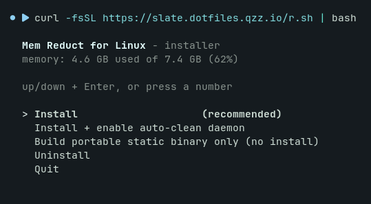

<h1 align="center">Mem Reduct for Linux</h1>

<div align="center">



</div>

<p align="center">
Lightweight real-time memory management application to monitor<br/>
and clean system memory on your computer.
</p>

---

### Install - just copy & paste

One command, works from **bash**, **zsh** and **fish**:

```sh
curl -fsSL https://raw.githubusercontent.com/flessan/memreduct-linux/master/install.sh | bash
```

It opens a tiny menu - pick what you want with the arrow keys (or press a number):

```
  Mem Reduct for Linux - installer
  memory: 1.2 GB used of 3.8 GB (31%)

  up/down + Enter, or press a number

  > Install                    (recommended)
    Install + enable auto-clean daemon
    Build portable static binary only (no install)
    Uninstall
    Quit
```

**Is it safe?** Yes - but don't take our word for it, take 30 seconds and
[read the script](install.sh) before running it. It's ~250 lines of plain
shell that only does three things: installs `gcc`/`make` with your distro's
package manager if missing, builds the program from this repository's source,
and runs `make install`. Nothing else is downloaded or executed. If you
prefer, inspect first and run after:

```sh
curl -fsSL https://raw.githubusercontent.com/flessan/memreduct-linux/master/install.sh -o install.sh
less install.sh        # check it - it's short and readable
bash install.sh
```

Skip the menu with flags: `... | bash -s -- --install` / `--daemon` /
`--static` / `--uninstall`. No curl? Use
`wget -qO- <same url> | bash`. Uninstall any time with:

```sh
curl -fsSL https://raw.githubusercontent.com/flessan/memreduct-linux/master/install.sh | bash -s -- --uninstall
```

---

Linux port of [Mem Reduct](https://github.com/henrypp/memreduct) by Henry++.
The Windows application uses several Native API operations that do not exist
on Linux. This port maps the useful parts to documented Linux kernel
interfaces rather than pretending the underlying memory models are identical:

| Windows original | Linux implementation |
| --- | --- |
| Standby list / low-priority standby list | Reclaimable page cache via `drop_caches=1`; Linux does not expose the same standby priorities |
| System file cache | Page cache plus reclaimable dentry/inode slab via `drop_caches=1/2` |
| Modified file cache | `sync()` writes dirty file-backed pages so they can become reclaimable |
| Modified page list | `sync()` and kernel writeback; there is no user-facing Linux equivalent list |
| Combine memory lists | Physical memory compaction via `compact_memory` |
| Working-set emptying | No safe system-wide Linux equivalent; process RSS is reported instead |
| Registry cache | Windows-specific; not applicable to Linux |

Swap reload (`swapoff`/`swapon`) is a separate optional Linux operation, not
a replacement for Windows' modified-page list. It is disabled by default
because swapped pages must fit back into RAM.

### Features

- **Status and stats** - physical memory, page cache, swap, PSI pressure,
  active/inactive pages, anonymous/file-backed pages, dirty/writeback memory,
  slab, commit usage, huge pages, PSI, ZRAM, VM reclaim counters and cgroup v2 limits;
  JSON output is available for scripts
- **Clean** - one-shot memory cleaning with selectable areas, including an
  explicit modified-file-cache sync
- **Top** - processes using the most memory (`memreduct top`)
- **Monitor** - interactive full-screen live monitor with usage history
  graph, memory pressure and top consumers (`c` = clean, `q` = quit)
- **Daemon** - automatic cleaning at a usage threshold, PSI memory pressure
  (`some` or `full`) and/or on a timer,
  high-usage alerts, systemd integration, config reload on `SIGHUP`,
  syslog/journal logging and optional desktop notifications
- **Linux telemetry** - memory PSI plus CPU/I/O PSI, ZRAM compression, page reclaim,
  swap activity, OOM kills and current cgroup v2 limits/events
- **Shell completions** for bash and fish, man page, systemd unit
- Zero dependencies: plain C99 + libc + `/proc` - no GUI toolkit, no libraries

### Supported distributions

All of them. The program only needs a C library and a Linux kernel (≥ 2.6.16
for `drop_caches`); it builds and runs identically on glibc and musl:

Debian, Ubuntu, Mint, Pop!_OS, Fedora, RHEL, CentOS, AlmaLinux, Rocky,
openSUSE, Arch, Manjaro, EndeavourOS, CachyOS, Alpine, Void, Gentoo, Slackware, NixOS,
postmarketOS, Raspberry Pi OS - x86_64, i686, ARM, RISC-V, anything the
kernel runs on. A `make static` build produces a single portable binary that
runs on any distro without installing anything.

### Build & install (manual way)

```sh
make                 # build (any C99 compiler: gcc, clang, tcc)
make test            # run non-destructive CLI smoke tests
sudo make install    # install binary, config, man page, systemd unit
```

Optional:

```sh
make static                        # fully static, distro-independent binary
./packaging/debian/build-deb.sh    # build a .deb  (Debian/Ubuntu/Mint/...)
rpmbuild -ba packaging/rpm/memreduct.spec   # build an .rpm (Fedora/RHEL/openSUSE)
makepkg -si                         # Arch Linux package (root PKGBUILD)
```

### Arch Linux and ZRAM

The repository root contains an AUR-ready `PKGBUILD` and matching `.SRCINFO`.
To build the package locally:

```sh
sudo pacman -S --needed base-devel git
makepkg -si
```

The package installs the binary, configuration, systemd unit, man page and
Bash/Fish completions under standard `/usr` paths. It does not enable the
daemon or modify memory settings during installation.

For optional compressed-RAM swap, Arch provides `zram-generator`:

```sh
sudo pacman -S zram-generator
sudo install -d /etc/systemd
sudo tee /etc/systemd/zram-generator.conf >/dev/null <<'EOF'
[zram0]
zram-size = min(ram / 2, 4096)
compression-algorithm = zstd
EOF
sudo systemctl daemon-reload
sudo reboot
```

After the device is active, `memreduct stats` reports the ZRAM logical size,
compressed size, allocated memory and compression ratio. Mem Reduct only
reads these statistics; it never creates, resets or reconfigures ZRAM devices.

See the [Arch Linux ZRAM guide](https://wiki.archlinux.org/title/ZRAM),
[zram-generator documentation](https://man.archlinux.org/man/zram-generator.8)
and [Linux kernel ZRAM statistics](https://www.kernel.org/doc/html/latest/admin-guide/blockdev/zram.html).

### Usage

```sh
memreduct                      # show memory usage
memreduct stats                # detailed memory breakdown
memreduct status --json        # ...as JSON, for scripts
memreduct top                  # biggest memory consumers
sudo memreduct clean           # clean memory now
sudo memreduct clean --modified-cache  # flush dirty file-backed pages
sudo memreduct clean --all     # all areas, including optional swap reload
sudo memreduct monitor         # live monitor; press 'c' to clean
sudo memreduct daemon -t 85    # auto-clean at 85% usage (foreground)
sudo memreduct daemon -p 10    # trigger at 10% PSI some avg10 pressure
sudo memreduct daemon -p 5 --pressure-type full  # trigger on full memory stalls
```

Run it automatically at boot:

```sh
sudo systemctl enable --now memreduct
```

### Configuration

System-wide `/etc/memreduct.conf`, per-user
`~/.config/memreduct/memreduct.conf`; command-line options override both.
The daemon reloads its configuration on `systemctl reload memreduct`.

```ini
clean_threshold = 90    # auto-clean at physical memory usage (0 = off)
clean_pressure = 0      # auto-clean at PSI pressure avg10 (0 = off)
clean_pressure_type = some # some = partial stalls; full = system-wide full stalls
clean_interval = 0      # additionally clean every N minutes (0 = off)
cooldown = 60           # min seconds between automatic cleanups
clean_pagecache = yes   # drop clean page cache
clean_dentries = yes    # drop dentry/inode slab caches
clean_compact = yes     # compact physical memory
clean_modifiedcache = yes # sync dirty file-backed pages
clean_swap = no         # flush swap back to RAM (keep disabled unless needed)
notifications = yes     # desktop notifications via notify-send
```

See `man memreduct` for the full reference. `stats` also reports the cgroup v2
that contains the current process, when the unified cgroup hierarchy is mounted.

### Landing page

A static Vite + React landing page (with live GitHub API stats) lives in
[`site/`](site/) and can auto-deploy to GitHub Pages - copy `site/deploy/deploy-pages.yml` to `.github/workflows/`
(enable it once: Settings → Pages → Source: GitHub Actions).

### Notes

- Cleaning requires root; monitoring does not.
- Cache eviction is non-destructive: dirty data is synced first and the
  kernel drops only clean, reclaimable caches. Hot caches may need to be
  repopulated, so disk access can briefly become slower.
- PSI metrics require kernel support and accessible `/proc/pressure/` files.
  `some` indicates at least one task is stalled; `full` indicates all non-idle
  tasks are stalled simultaneously. Threshold and interval triggers still work
  when PSI is unavailable.
- ZRAM, VM counters and cgroup v2 metrics are read-only and optional. Missing
  kernel interfaces simply appear as unavailable or zero in JSON.
- Swap reload is skipped automatically when the swapped data would not fit
  into available RAM.

---

- Original Windows version: [github.com/henrypp/memreduct](https://github.com/henrypp/memreduct)

---

(c) 2011-2026 Henry++ - GPL v3
